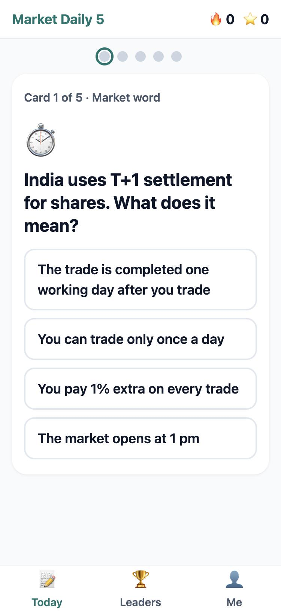
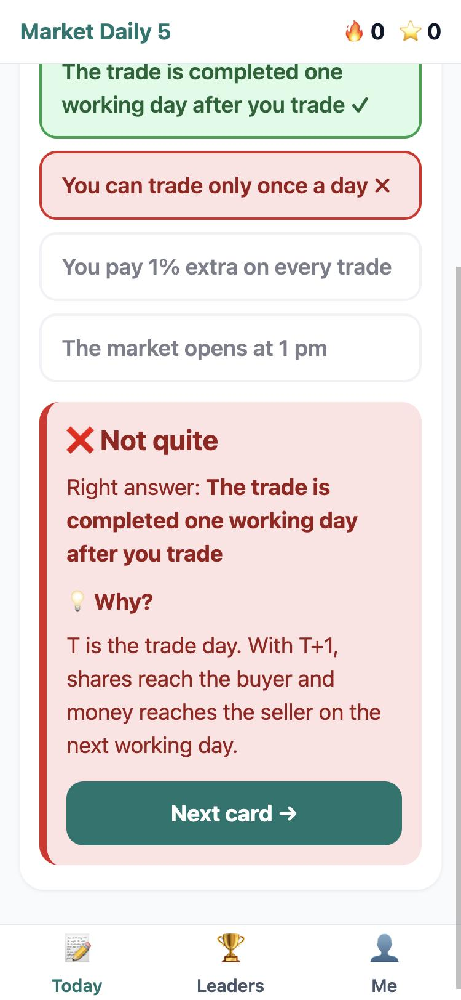
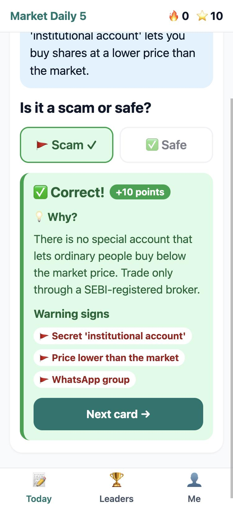
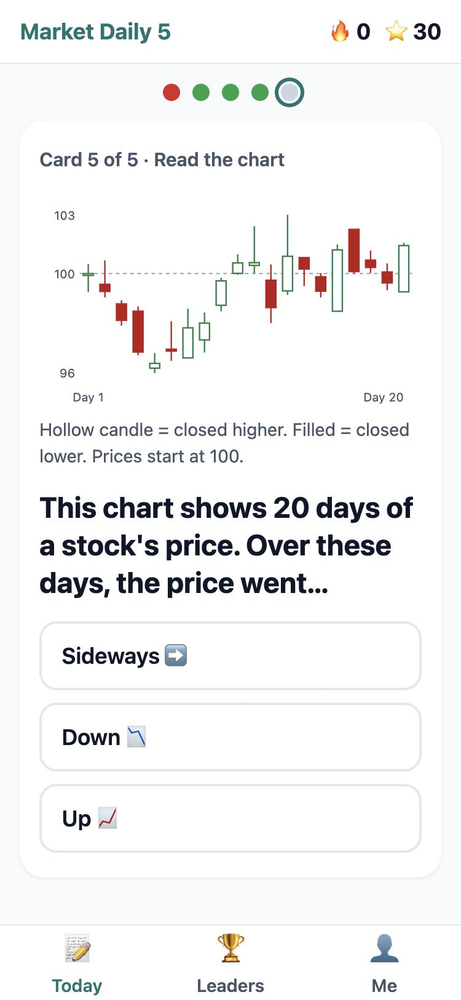
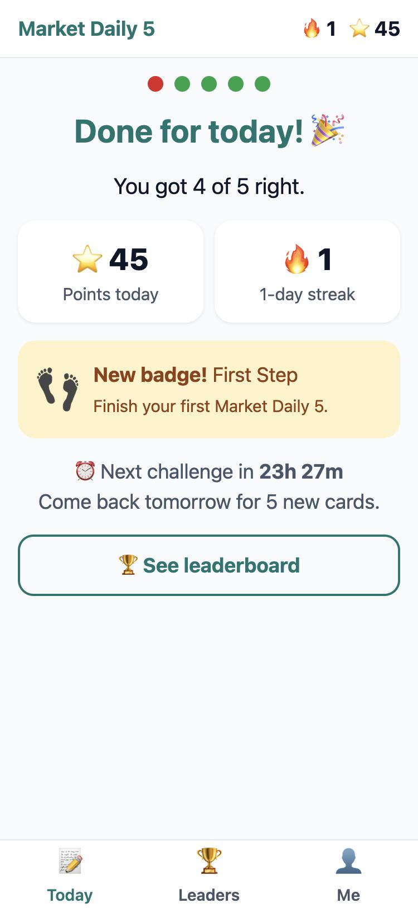

# Market Daily 5: explainer

**Live:** **https://daily5.tradertrix.com** (best opened on a phone) · **Code:** this repository

> **In 30 seconds**
>
> - **What:** a one-minute daily habit: 5 cards (market words, "Scam or Safe?" messages, and a real
>   NSE chart). Points, a streak, badges and a weekly leaderboard bring people back.
> - **Why it fits your users:** it teaches how to protect and grow money, rewards *learning, never
>   predictions*, uses plain English, and is ~81 KB on a phone, so it loads fast on mobile data.
> - **How it's built:** the server decides every point (append-only ledger, rules enforced in the
>   database, tested under simultaneous requests); one Docker image, auto-deployed from GitHub on
>   every merge with automatic rollback.
> - **Left out:** email login (designed, not built), offline mode, Hindi, reminders. Details below.
> - **AI:** built with Claude Code; I made the decisions and reviewed and tested every step (see below).

  
  
  
  
  

## What I built

**Market Daily 5** is a one-minute daily habit about money and markets in India. Every day you get
**5 short cards**:

| Cards | What you do |
|---|---|
| 2 × 📚 **Market word** | Pick what a term means: SIP, T+1, stop-loss, circuit limit… |
| 2 × 🛡️ **Scam or Safe?** | Read a realistic message ("Guaranteed 5% daily! Join my Telegram VIP") and tap 🚩 Scam or ✅ Safe |
| 1 × 📈 **Read the chart** | 20 days of a real NSE stock (name hidden): is the trend up, down or sideways? What kind of candle is the last one? |

After every answer you see the right answer and a short **"💡 Why?"**, so a wrong answer still teaches
something. Answering brings **+10 points**, finishing all 5 adds a **+5 bonus** and extends your
**🔥 streak** (one free "streak freeze" a week forgives a missed day). There are **badges** and a
**weekly leaderboard**. You start as a guest: no sign-up stands between opening the link and the
first card.

## Why this idea

I started from what you told me about your users:

- **Their earnings are worth real money.** So the topic is protecting and growing money (scams cost
  people dearly, and most beginners lose money in F&O). It also set the most important rule:
  **reward learning, never predictions.** Points come only from knowledge questions. Even the chart
  cards ask what the chart *shows*, never what happens next, so the app can't turn into betting or
  "stock tips".
- **Many read English as a second language.** One idea per card, short sentences, common words, icons
  next to key words, and all the text in one file, ready for Hindi.
- **Modest Android phones on mobile data.** The whole app is about **81 KB of JavaScript + 2 KB of CSS**
  (gzipped), with no UI or chart libraries. Buttons are at least 56 px tall. If an answer fails to send,
  the app says so and resends the *same* request, which can never be counted twice.

## The choices that matter

**The server decides everything worth points.** The app only shows what the server says. Points live
in an **append-only ledger**, and the database itself enforces the money rules: a trigger blocks edits
to the ledger, unique keys stop the same reward being paid twice, you can answer each card once, and
only cards in that day's challenge. Each user's answers are processed one at a time. I tested that by
removing the lock and firing 5 answers at once: without it the daily bonus was skipped and a double
tap caused an error; with it, the bonus is paid exactly once.

**Answers stay on the server until you answer.** The day's cards are sent without answers or
explanations; a test checks the raw response.

**One clock: India time.** A day runs midnight to midnight IST for everyone, for challenges, streaks
and leaderboard weeks, so "today's challenge" and "today's streak" can't disagree.

**Fresh content every day, automatically.** A job runs every evening after market close (and on every
deploy). It fetches recent prices, finds a 20-day window with a clear-cut answer (a 3% move is
neither "up" nor "sideways", so it's skipped), hides the stock's name, rescales prices to start at 100,
and builds the next 7 days.

**Stack:** React + Vite on the front, Node.js + Fastify + Postgres on the back, TypeScript throughout,
with request/response types shared between the two. I considered Java (my background) but Node fits a
small, I/O-bound service on a small server better. I chose React over lighter options so a future
React Native app can reuse all the non-UI code.

**Shipping.** One Docker image (API + web on the same domain), built by GitHub Actions on every merge
to `main`, pushed to GHCR, and deployed to a server in **Bangalore** over SSH with a key that can do
nothing except deploy. The server checks the new version is healthy and **rolls back automatically**
if not. A merge is live in about 2 minutes. I avoided free hosts that sleep, because a reviewer opening
the link would wait 30–60 seconds.

## What I left out, and why

| Left out | Why / what I'd do next |
|---|---|
| **Email login** | Designed (guest first; email OTP to save progress and claim rewards; phone OTP later without schema changes) and the tables exist, but not built. Guests can play fully. **Before rewards become real money, verified accounts are essential**: today one person could create many guest accounts to farm the leaderboard. |
| **Offline mode** | Failed answers retry safely, but there's no service worker yet, so the app needs a connection to open. |
| **Hindi and other languages** | All text is in one file to make this easy; the cards themselves need careful translation, not machine output. |
| **Reminders** | A daily push or WhatsApp nudge would help retention most, but needs consent and a messaging setup. |
| **Rate limiting and abuse checks** | Needed before launch, especially for login and the leaderboard. |
| **Content review by an expert** | I wrote the 60 cards in plain language and kept to facts that don't change often, but financial content for real users should be reviewed by someone qualified. |
| **Licensed market data** | Yahoo Finance's free endpoint is fine for a demo but unofficial. It sits behind an interface, so a licensed feed is a drop-in replacement. |
| **Levels, more chart patterns, an admin tool for cards** | Nice to have; less important than the above. |

## How I used AI tools

I built this with **Claude Code** (Anthropic's coding agent) throughout, and I want to be clear about
the split:

- **I made the decisions:** the topic and the "learn, don't predict" rule, the three card types,
  Node over Java, React for a future React Native app, guest-first with email OTP later, the IST day,
  daily generated chart cards from Yahoo data, hosting on my own DigitalOcean server with Docker and a
  GitHub Actions pipeline, the subdomain, and keeping a step-by-step build log.
- **Claude wrote most of the code, tests, documentation and card text** from those decisions, and
  helped me compare options (for example, which hosts sleep, and why Render's free tier was the wrong
  fit). I reviewed every step and asked for changes.
- **Verification wasn't left to trust.** Every step was tested: 81 automated tests, playing the app in
  a phone-sized browser, deliberately breaking code to prove the tests catch it, and checking the live
  server. Mistakes were caught this way, including a real one in production: the first deploy connected
  to the *other* product's database because both services were called `db` on a shared Docker network.
  It was diagnosed, reproduced and fixed the same night.

The full log of where AI was used is at the end of [docs/brainstorm.md](docs/brainstorm.md), and
[docs/BUILD_LOG.md](docs/BUILD_LOG.md) records every step, including what went wrong.

## Where to look

| If you want… | Read |
|---|---|
| How to run it locally (a few commands) | [README.md → Getting started](README.md#getting-started) |
| Why each decision was made | [docs/brainstorm.md](docs/brainstorm.md) |
| How it was built, step by step, with problems and fixes | [docs/BUILD_LOG.md](docs/BUILD_LOG.md) |
| How it's deployed and operated | [deploy/README.md](deploy/README.md) |
| The game rules in code | [`apps/api/src/services/submissions.ts`](apps/api/src/services/submissions.ts), [`streaks.ts`](apps/api/src/services/streaks.ts), [`market/chart-rules.ts`](apps/api/src/market/chart-rules.ts) |
| The money rules in the database | [`db/migrations/0003_gameplay.sql`](db/migrations/0003_gameplay.sql) |
