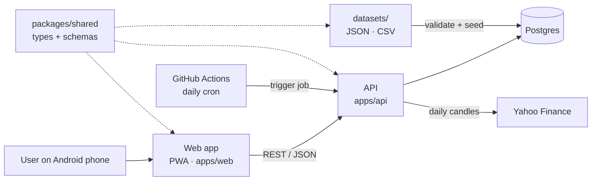

# daily-loop

A lightweight, mobile-first web app built around a short daily task with streaks, points and badges. Rewards are checked on the server and question sets are versioned and loaded into Postgres.

> **Status:** architecture and planning. The full thought process and decision log live in [docs/brainstorm.md](docs/brainstorm.md).

---

## Who we are building for

Every architecture choice below follows from three facts about the users:

| Fact | What it means for the design |
|---|---|
| Modest Android phones on mobile data | Small JS bundle (target < ~150 KB), light assets, fast first load on 3G, works offline |
| English is often a second language | Short, plain words; icons next to text; all UI strings in one file so translation is easy later |
| Rewards are worth real money to them | Rewards are calculated only on the server, recorded once, and never lost or double-counted |

---

## The daily challenge: Market Daily 5

A one-minute daily habit that builds financial literacy around trading in India.
Every day the user answers **5 short cards**:

| Cards | Type | What the user does |
|---|---|---|
| 2 | 📚 **Market word** | Picks the right meaning of a term such as SIP, T+1, circuit limit or stop-loss |
| 2 | 🛡️ **Scam or Safe?** | Reads a realistic message ("Guaranteed 5% daily! Join my Telegram VIP") and taps 🚩 Scam or ✅ Safe |
| 1 | 📈 **Read the chart** | Sees a past candlestick snippet (stock name hidden) and names the pattern or trend |

After each answer a short **"Why?"** explanation appears, so even a wrong answer teaches something.

**Rewards**

| Mechanic | Rule |
|---|---|
| Points | +10 per correct answer, +5 for finishing all 5 |
| Streak | 🔥 consecutive days, with 1 free streak freeze per week |
| Badges | 🛡️ Scam Spotter · 📈 Chart Reader · 📚 7-Day Learner |
| Leaderboard | Weekly, by points |

**Guardrail: we reward learning, never market predictions.** Points come only from answering
knowledge questions correctly. There is no betting on prices and no stock tips; chart cards use
past data with the stock name hidden.

---

## Architecture

**One rule: the frontend shows things, the backend decides things.**



| Concern | Frontend (`apps/web`) | Backend (`apps/api`) |
|---|---|---|
| Showing the task | Renders the task | Serves today's task **without answers** |
| Submitting | Sends answer + idempotency key | Validates, scores, records exactly once |
| Points and streaks | Displays them | Calculates them; append-only ledger |
| Badges | Celebration UI | Rules decide when they are awarded |
| Leaderboard | Displays it | Aggregates it (cached) |
| Offline | Queues submissions, retries later | Idempotent, so retries never pay twice |

### Stack

| Layer | Choice | Why |
|---|---|---|
| Frontend | React + Vite, PWA, TypeScript | Offline support, installable on Android, and a path to a React Native app |
| Backend | Node.js + Fastify, TypeScript | I/O-bound workload, shared types with the frontend, fast cold starts on free tiers |
| Database | Postgres (Neon or Supabase free tier) | Reliable transactions for rewards; free hosting |
| Hosting | Cloudflare Pages / Vercel (web), Render / Fly.io (API) | Free tiers, simple deploys |

**Why Node.js, not Java?** Java was considered with future scale in mind, but at this app's scale
the limit is the architecture, not the language. Node handles small JSON reads and writes very well,
shares types with the frontend, and wakes up in about a second on free hosting (a Java app can take
5 to 15 seconds, which means a blank screen on a phone).

**How it scales later:** the API is stateless, so we run more instances; Postgres gets connection
pooling and read replicas; the leaderboard moves to Redis; background work (badges, daily challenge
generation) moves to a job queue; any CPU-heavy service can be split out on its own.

**Path to a mobile app:** React Native cannot reuse web screens, but it can reuse everything else.
So all non-UI code (types, validation, API client, hooks) lives in `packages/shared`, and `apps/web`
holds only screens. A future `apps/mobile` (React Native) only needs its own screens.

---

## Login: guest first, email OTP to save progress

```
Open app → play as guest → "Save your streak 🔥" → enter email → 6-digit OTP → same account, now verified
```

- **Play first, log in later.** Anyone opening the link is answering the first card within seconds.
  A verified email is required **before points can be claimed or redeemed**, and keeps progress safe across phone changes.
- **Email OTP, no passwords.** It is effectively free and every Android user has a Gmail account.
  Phone OTP in India needs DLT registration for SMS (or WhatsApp Business approval), so it comes later.
- **Ready for phone login.** A person (`users`) is separate from how they log in (`identities`: device, email, phone).
  OTPs are sent through one `OtpSender` interface: email now, SMS or WhatsApp later, with no schema change.
- **OTP safety:** 6 digits, 10-minute expiry, single use, max 5 attempts, stored only as a hash,
  rate-limited per email and IP; session in an httpOnly cookie. In local development the OTP is printed
  to the console, so setup needs no email account.

---

## Daily challenge generation

Each day's 5 cards are **pre-generated by a backend job**, 7 days ahead.

```
GitHub Actions (daily, 18:30 IST) → POST /internal/jobs/generate-challenges (secret header)
  1. Fetch recent daily candles from Yahoo Finance for a few NIFTY 50 symbols
  2. Save them to market_candles (internal only)
  3. Build 1 chart card: past window, name hidden, answer computed by rules
  4. Pick 2 term + 2 scam cards not shown recently
  5. Insert any missing daily_challenges rows for the next 7 days
```

- **Never an empty day.** A 7-day buffer covers a failed run, and if no row exists `GET /api/today`
  builds one from a small fallback set.
- **Idempotent.** One row per date; re-running the job never duplicates or changes a day already served.
- **Chart cards teach, never predict.** Prices are rescaled to start at 100 and the stock is unnamed.
  The answer comes from the data shown (e.g. trend up/down/sideways, "the last candle is a hammer"),
  never from what happens next.
- **Swappable data source.** Yahoo Finance has no official API and limits commercial use, so it sits behind
  a `MarketDataProvider` interface. It is fine for this demo; production would plug in a licensed feed.
- **Why GitHub Actions?** Free-tier servers sleep, so an in-process cron can't be trusted.
  The scheduled HTTP call wakes the server and runs the job.

---

## Data model (first draft)

```
users            id, display_name, timezone, created_at
identities       id, user_id, type('device'|'email'|'phone'), value, verified_at
                 UNIQUE(type, value)
otp_codes        id, identity_type, value, code_hash, expires_at, attempts, used_at
sessions         id, user_id, token_hash, expires_at, revoked_at
datasets         id, name, version, source, content_hash, loaded_at
tasks            id, dataset_id, type('term'|'scam'|'chart'), prompt, options(jsonb),
                 answer(hidden), explanation, payload(jsonb), difficulty, language, active,
                 source('dataset'|'generated'), created_at
daily_challenges date UNIQUE, task_ids[5], bonus_multiplier, generated_at
                 -- one row per day: 2 term, 2 scam, 1 chart; pre-generated 7 days ahead
market_candles   symbol, date, open, high, low, close, volume, provider, fetched_at
                 PRIMARY KEY(symbol, date)                         -- internal only, never sent to clients
job_runs         id, job, started_at, finished_at, status, details(jsonb)   -- audit of each generation run
submissions      id, user_id, task_id, challenge_date, answer, is_correct,
                 idempotency_key UNIQUE, created_at
points_ledger    id, user_id, delta, reason, ref_id, created_at   -- append-only
streaks          user_id, current, longest, last_active_date, freezes_left
badges           id, code, name, rule(jsonb), icon
user_badges      user_id, badge_id, awarded_at
```

Key ideas:

- **The points ledger is the source of truth.** A balance is `SUM(delta)`. Rows are never edited or deleted, so every point can be traced.
- **Idempotency keys** on submissions stop a retry on a weak network from rewarding twice.
- **Streaks follow the user's local timezone**, so late-night activity counts for the right day.
- **Streak freezes** forgive a missed day, which matters for people with patchy connectivity.

---

## Datasets

Task content is kept in `datasets/` as JSON, versioned in git:

```
datasets/
├── terms.json           # id, question, options[], answer, explanation, icon
├── scams.json           # id, message, is_scam, red_flags[], explanation
├── chart_universe.json  # symbols the chart generator may use (e.g. NIFTY 50 tickers)
└── charts_fallback.json # a few hand-made chart cards, used only if market data is unavailable
```

Term and scam cards are hand-written. Chart cards are generated daily from Yahoo Finance (see above).

1. Each item has a **stable ID** (e.g. `q_0001`).
2. The seed script in `db/seed/` **validates** every file against the shared schemas.
3. Items are **upserted** by ID and the file's `content_hash` is recorded, so re-seeding is always safe.

Adding new content means editing a dataset file and re-running the seed. No code changes.

---

## API (draft)

```
POST /api/session            create or restore a guest user (device token) -> session cookie
POST /api/auth/otp/request   { email } -> sends a 6-digit OTP (rate-limited)
POST /api/auth/otp/verify    { email, code } -> links the email to the current user
POST /api/auth/logout        revokes the session
GET  /api/today              today's challenge (no answers)
POST /api/submissions        { taskId, answer, idempotencyKey } -> result + rewards
GET  /api/me                 points balance, streak, badges
GET  /api/leaderboard?week=  top N + my rank

POST /internal/jobs/generate-challenges   (X-Job-Secret header) pre-generates the next 7 days
```

---

## Repository layout

```
daily-loop/
├── apps/
│   ├── web/          # frontend (PWA)
│   └── api/          # backend (REST API)
├── packages/
│   └── shared/       # types, schemas, API client, hooks (no UI; reusable by React Native)
├── datasets/         # versioned content (JSON/CSV)
├── db/
│   ├── migrations/   # SQL migrations
│   └── seed/         # validate + load datasets into the DB
└── docs/
    └── brainstorm.md # thought process and decision log
```

---

## Getting started

_Coming soon._ Setup steps will be added once the first version of the app and API is in place.

## Use of AI tools

AI tools (Claude) were used to help draft the architecture and documentation. Details are tracked in [docs/brainstorm.md](docs/brainstorm.md#8-where-ai-tools-were-used).

## License

See [LICENSE](LICENSE).
