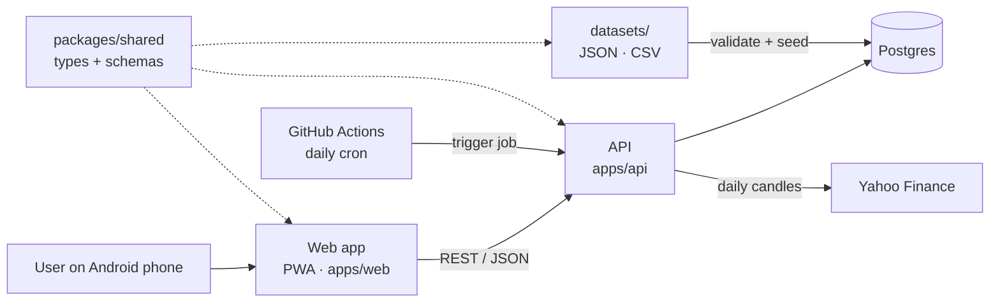

# daily-loop

A lightweight, mobile-first web app built around a short daily task with streaks, points and badges. Rewards are checked on the server and question sets are versioned and loaded into Postgres.

> **Live:** **https://daily5.tradertrix.com** (open it on a phone). Deployed automatically on every merge to `main`.
>
> **Start here: [EXPLAINER.md](EXPLAINER.md)**: what I built, the choices I made, what I left out, and how AI was used.
>
> **Status:** playable end to end: guest start, 5 daily cards (including real chart cards), points,
> streaks, badges and a weekly leaderboard. Email login is designed but not built yet.
>
> - **Why** things are built this way: [docs/brainstorm.md](docs/brainstorm.md) (decisions and reasoning)
> - **How** the code was built, step by step: [docs/BUILD_LOG.md](docs/BUILD_LOG.md) (learning journal)

---

## Who we are building for

Every architecture choice below follows from three facts about the users:

| Fact | What it means for the design |
|---|---|
| Modest Android phones on mobile data | Small JS bundle (target < ~150 KB), light assets, fast first load on 3G, works offline |
| English is often a second language | Short, plain words; icons next to text; all UI strings in one file so translation is easy later |
| Rewards are worth real money to them | Rewards are calculated only on the server, recorded once, and never lost or double-counted |

---

## The daily challenge: Market Daily 5

A one-minute daily habit that builds financial literacy around trading in India.
Every day the user answers **5 short cards**:

| Cards | Type | What the user does |
|---|---|---|
| 2 | 📚 **Market word** | Picks the right meaning of a term such as SIP, T+1, circuit limit or stop-loss |
| 2 | 🛡️ **Scam or Safe?** | Reads a realistic message ("Guaranteed 5% daily! Join my Telegram VIP") and taps 🚩 Scam or ✅ Safe |
| 1 | 📈 **Read the chart** | Sees a past candlestick snippet (stock name hidden) and names the pattern or trend |

After each answer a short **"Why?"** explanation appears, so even a wrong answer teaches something.

**Rewards**

| Mechanic | Rule |
|---|---|
| Points | +10 per correct answer, +5 for finishing all 5 |
| Streak | 🔥 consecutive days, with 1 free streak freeze per week |
| Badges | 🛡️ Scam Spotter · 📈 Chart Reader · 📚 7-Day Learner |
| Leaderboard | Weekly, by points |

**Guardrail: we reward learning, never market predictions.** Points come only from answering
knowledge questions correctly. There is no betting on prices and no stock tips; chart cards use
past data with the stock name hidden.

---

## The app

Three tabs, one idea per screen, big buttons (56px+), icons next to words, works in light and dark mode.

| Screen | What the user sees |
|---|---|
| **Today** | 🔥 streak and ⭐ points at the top, 5 progress dots, one card at a time. Tap an answer → ✅/❌, **+10 points**, the right answer, a short **"💡 Why?"** and, for scams, the 🚩 warning signs → **Next card** |
| **Done** | "You got 4 of 5 right", points today, streak, any **new badge**, and a countdown to the next challenge (midnight IST) |
| **Leaders** | This week's top 10 (🥇🥈🥉), your row highlighted, your rank |
| **Me** | Points, streak, best streak, streak freeze 🧊, display name for the leaderboard, badges (earned or 🔒) |

Built for patchy mobile data:
- If an answer fails to send, the app says so and offers **Try again**. The retry reuses the same
  idempotency key, so it can never be counted twice.
- Opening the app on a new IST day loads the new challenge automatically.
- The whole app is about **80 KB of JavaScript + 2 KB of CSS** (gzipped), with no UI libraries.

---

## Architecture

**One rule: the frontend shows things, the backend decides things.**



| Concern | Frontend (`apps/web`) | Backend (`apps/api`) |
|---|---|---|
| Showing the task | Renders the task | Serves today's task **without answers** |
| Submitting | Sends answer + idempotency key | Validates, scores, records exactly once |
| Points and streaks | Displays them | Calculates them; append-only ledger |
| Badges | Celebration UI | Rules decide when they are awarded |
| Leaderboard | Displays it | Aggregates it (cached) |
| Offline | Queues submissions, retries later | Idempotent, so retries never pay twice |

### Stack

| Layer | Choice | Why |
|---|---|---|
| Frontend | React + Vite, PWA, TypeScript | Offline support, installable on Android, and a path to a React Native app |
| Backend | Node.js + Fastify, TypeScript | I/O-bound workload, shared types with the frontend, small memory footprint |
| Database | Postgres 16 | Reliable transactions and constraints for rewards |
| Hosting | One Docker image (API + web) on a DigitalOcean droplet in Bangalore, behind Caddy (HTTPS) | Always on (no free-tier sleep), close to Indian users, one domain |
| CI/CD | GitHub Actions → GHCR → SSH deploy with automatic rollback | Every merge to `main` is tested, built and shipped (see [Deployment](#deployment)) |

**Why Node.js, not Java?** Java was considered with future scale in mind, but at this app's scale
the limit is the architecture, not the language. Node handles small JSON reads and writes very well,
shares types with the frontend, starts in about a second, and runs in ~30 MB of RAM, which matters on
a small shared server (a Spring Boot app typically needs 300+ MB and several seconds to start).

**How it scales later:** the API is stateless, so we run more instances; Postgres gets connection
pooling and read replicas; the leaderboard moves to Redis; background work (badges, daily challenge
generation) moves to a job queue; any CPU-heavy service can be split out on its own.

**Path to a mobile app:** React Native cannot reuse web screens, but it can reuse everything else.
So all non-UI code (types, validation, API client, hooks) lives in `packages/shared`, and `apps/web`
holds only screens. A future `apps/mobile` (React Native) only needs its own screens.

---

## Login: guest first, email OTP to save progress

```
Open app → play as guest → "Save your streak 🔥" → enter email → 6-digit OTP → same account, now verified
```

- **Play first, log in later.** Anyone opening the link is answering the first card within seconds.
  A verified email is required **before points can be claimed or redeemed**, and keeps progress safe across phone changes.
- **Email OTP, no passwords.** It is effectively free and every Android user has a Gmail account.
  Phone OTP in India needs DLT registration for SMS (or WhatsApp Business approval), so it comes later.
- **Ready for phone login.** A person (`users`) is separate from how they log in (`identities`: device, email, phone).
  OTPs are sent through one `OtpSender` interface: email now, SMS or WhatsApp later, with no schema change.
- **OTP safety:** 6 digits, 10-minute expiry, single use, max 5 attempts, stored only as a hash,
  rate-limited per email and IP; session in an httpOnly cookie. In local development the OTP is printed
  to the console, so setup needs no email account.

---

## Daily challenge generation

Each day's 5 cards are **pre-generated by a backend job**, 7 days ahead. A new challenge day
starts at **midnight IST** for everyone.

```
server cron, 18:30 IST (after market close)  ─┐
every deploy (after migrations + seed)        ─┴─► node dist/generate.js  (inside the app container)
  for each of the next 7 days without a challenge:
    1. fetch ~6 months of daily candles for a random NSE large cap (Yahoo Finance)
    2. store them in market_candles (internal only)
    3. find a 20-day window with a clear-cut answer → chart card chart_<date>
       (stock name hidden, prices rescaled so the first close = 100)
  then build each missing day: 2 market words + 2 scam-or-safe + that day's chart
  record the run in job_runs
```

**Chart cards** (alternating by day):

| Question | Correct answer computed from the candles shown |
|---|---|
| "Over these 20 days, the price went…" Up 📈 / Down 📉 / Sideways ➡️ | Up if the last close is > 5% above the first, Down if > 5% below, Sideways if within 2%. Windows between 2% and 5% are skipped as ambiguous |
| "What kind of candle is the last one (highlighted)?" Green / Red / Doji | Doji if the body is ≤ 10% of the day's range; Green/Red if the body is ≥ 50%. Anything in between is skipped |

The explanation quotes the numbers ("It started at 100.0 and ended at 91.9, down 8.1%…") and ends with
*"This is past data from a real stock, with its name hidden. It is not a tip."* The chart is drawn as
plain SVG (+1.3 KB); rising candles are hollow and falling ones filled, so they're distinguishable
without colour.

- **Never an empty day.** 7 days are built ahead. If market data fails, the job still builds the
  days (the chart slot reuses an older chart, or falls back to a market word), and the app builds a
  missing day on demand.
- **Idempotent.** One row per date; re-running the job never duplicates or changes a day already built.
- **Teach, never predict.** The answer comes from the data on screen, never from what happens next.
- **Swappable data source.** Yahoo Finance has no official API and limits commercial use, so it sits behind
  a `MarketDataProvider` interface. Fine for this demo; a production product would plug in a licensed
  feed. Only the 24 symbols in [`datasets/chart_universe.json`](datasets/chart_universe.json) are used.
- **Why a server cron, not GitHub Actions?** The original plan used a scheduled GitHub workflow because
  free hosts sleep. The app now runs on an always-on server, so a local cron is simpler and needs no
  public endpoint or shared secret.

---

## Data model

The schema lives in plain SQL files in [`db/migrations/`](db/migrations), applied in order by a small
runner (`npm run db:migrate`).

```
-- 0001_users_and_auth.sql
users                  id, display_name, timezone, created_at
identities             id, user_id, type('device'|'email'|'phone'), value, verified_at   UNIQUE(type, value)
otp_codes              id, identity_type, value, code_hash, expires_at, attempts, used_at
sessions               id, user_id, token_hash UNIQUE, expires_at, revoked_at

-- 0002_content.sql
datasets               id, name, version, source, content_hash, item_count, loaded_at
tasks                  id, dataset_id, type('term'|'scam'|'chart'), source('dataset'|'generated'),
                       prompt, options(jsonb), answer, explanation, payload(jsonb), difficulty, active
                       CHECK answer is one of options
daily_challenges       date PK, bonus_multiplier, generated_at          -- one row per IST day
daily_challenge_tasks  challenge_date, position(1-5), task_id           UNIQUE(challenge_date, task_id)

-- 0003_gameplay.sql
submissions            id, user_id, challenge_date, task_id, answer, is_correct, idempotency_key UNIQUE
                       FK (challenge_date, task_id) -> daily_challenge_tasks;  UNIQUE(user_id, challenge_date, task_id)
points_ledger          id, user_id, delta <> 0, reason, ref_id          UNIQUE(user_id, reason, ref_id); append-only trigger
streaks                user_id PK, current, longest, last_active_date, freezes_left, freeze_week
badges                 id, name, description, icon, rule(jsonb), sort_order
user_badges            user_id, badge_id, awarded_at

-- 0004_market_data_and_jobs.sql
market_candles         symbol, date, open, high, low, close, volume, provider   -- internal only
job_runs               id, job, status, started_at, finished_at, details(jsonb)
```

Key ideas, **enforced by the database itself**, not only by application code (and covered by tests):

- **The points ledger is the source of truth.** A balance is `SUM(delta)`. A trigger rejects any
  `UPDATE` or `DELETE`, so every point can be traced.
- **Nothing is rewarded twice.** `UNIQUE(user_id, reason, ref_id)` on the ledger, even if code runs twice.
- **One answer per card per day**, and **idempotency keys** make a retry on a weak network a no-op.
- **A submission must be for a card in that day's challenge** (composite foreign key).
- **One day boundary: midnight to midnight IST.** Challenges, streaks and leaderboard weeks (Monday to Sunday)
  all use India time, so "today's challenge" and "today's streak" can never disagree.
- **Streak freezes** forgive a missed day, which matters for people with patchy connectivity.

---

## Datasets

Task content is kept in `datasets/` as JSON, versioned in git:

```
datasets/
├── terms.json    # 30 "Market word" cards: id, question, answer, distractors[], explanation, icon, difficulty
├── scams.json    # 30 "Scam or Safe?" cards (20 scams, 10 safe): id, message, is_scam, red_flags[], explanation
├── badges.json   # 4 badges: id, name, description, icon, rule
└── chart_universe.json  # 24 NSE large caps the chart generator may use (read by the job, not seeded)
```

Term and scam cards are hand-written in short, plain English. Chart cards are generated daily from
Yahoo Finance (see above).

How the seed works (`npm run db:seed`):

1. Every file is **validated** against the schemas in `packages/shared` (plus rules such as unique IDs,
   distractors different from the answer, red flags only on scams). **If any file is invalid, nothing is written.**
2. Each item has a **stable ID** (e.g. `term_0001`) and is **upserted** by it.
3. The file's **sha256** is stored in `datasets`; an unchanged file is skipped.
4. An item removed from a file is **deactivated, not deleted**, because past answers still point to it.

Adding content means editing a dataset file, running `npm run datasets:check`, then `npm run db:seed`. No code changes.

---

## API

Request and response shapes are defined once in [`packages/shared/src/api.ts`](packages/shared/src/api.ts)
and used by both the API (to validate requests) and the typed client (to validate responses).

| Endpoint | Status | What it does |
|---|---|---|
| `GET /api/health` | ✅ | API and database status |
| `POST /api/session` | ✅ | `{ deviceToken }` → finds or creates the guest user, sets an httpOnly session cookie |
| `GET /api/today` | ✅ | Today's 5 cards (IST). Answers and explanations only on cards already answered |
| `POST /api/submissions` | ✅ | `{ challengeDate, taskId, answer, idempotencyKey }` → result, rewards, new badges, streak, total |
| `GET /api/me` | ✅ | Points, streak, all badges (earned or not) |
| `PATCH /api/me` | ✅ | `{ displayName }` for the leaderboard (2–20 letters, digits, spaces) |
| `GET /api/leaderboard` | ✅ | This week's top 10 (Monday to Sunday, IST) + your rank |
| `POST /api/auth/otp/request`, `/verify`, `/logout` | ⏳ | Email OTP login (next step) |
| `

Errors always look like `{ "error": { "code": "already_answered", "message": "…" } }`:

| Status | Codes |
|---|---|
| 400 | `invalid_request`, `invalid_answer`, `challenge_closed` |
| 401 | `not_signed_in` |
| 404 | `card_not_found` |
| 409 | `already_answered`, `idempotency_key_reused` |

**How a submission is scored** (all in one database transaction, see
[`services/submissions.ts`](apps/api/src/services/submissions.ts)):

1. A repeated `idempotencyKey` returns the original result with `replayed: true` and no new rewards.
2. The card must be in that day's challenge, not answered yet, and the answer must be one of its options.
   Yesterday's challenge stays open for 15 minutes after midnight IST.
3. Correct answer: **+10**. Fifth card answered: **+5** daily bonus and the streak updates.
4. Badges whose rule is now met are awarded.

Each user's submissions are processed one at a time (a Postgres advisory lock), so answering several
cards at once, or double-tapping, can never pay the daily bonus twice or skip it.

---

## Repository layout

```
daily-loop/
├── apps/
│   ├── web/          # frontend: React + Vite
│   │   └── src/
│   │       ├── useGame.ts    # all game state + actions (session, answer, retry, reload)
│   │       ├── screens/      # Today (cards + Done), Leaders, Me
│   │       ├── components/   # TopBar, TabBar, ProgressDots, CardView (+ result)
│   │       ├── strings.ts    # every user-facing sentence, in plain English
│   │       └── device.ts     # device token + random IDs
│   └── api/          # backend: Node.js + Fastify REST API
│       ├── src/
│       │   ├── app.ts        # builds the Fastify app (deps: pool + clock), auth hook, error format
│       │   ├── routes/       # HTTP endpoints: thin, validate input and call services
│       │   ├── services/     # game logic: challenges, submissions, streaks, badges, sessions
│       │   ├── lib/          # small helpers: db transactions/locks, crypto, shuffle, errors
│       │   ├── migrate.ts    # migration runner
│       │   ├── seed/         # validate + load datasets into the DB
│       │   └── scripts/      # CLI entry points: migrate, seed, reset, check datasets
│       └── test/             # Vitest: rules (pure), API (via app.inject), database rules
├── packages/
│   └── shared/       # types, schemas, API client, hooks (no UI; reusable by React Native)
├── datasets/         # versioned content (JSON)
├── db/
│   └── migrations/   # numbered SQL migrations (0001_..., 0002_...)
├── docs/
│   ├── brainstorm.md # thought process and decision log
│   └── BUILD_LOG.md  # step-by-step build journal
├── docker-compose.yml  # local Postgres
└── package.json        # npm workspaces + root scripts
```

It is a **monorepo using npm workspaces** (built into npm, no extra tooling). One `npm install` at the
root installs everything, and `apps/api` and `apps/web` import `@daily-loop/shared` directly.

---

## Getting started

### Prerequisites

- **Node.js 20.19+** (22 recommended, see `.nvmrc`)
- **Docker** (for the local Postgres database)

### Run it locally

```bash
git clone https://github.com/ash-1202/daily-loop.git
cd daily-loop
cp .env.example .env     # defaults work as-is
npm install
npm run db:up            # starts Postgres in Docker on port 5433
npm run db:setup         # creates the tables and loads the datasets
npm run dev              # starts the API (port 3000) and the web app (port 5173)
```

Open **http://localhost:5173** (use your browser's phone view, or open it on a phone on the same
Wi-Fi via the Network URL Vite prints). You start as a guest and see today's first card.

> Postgres runs on host port **5433** (not the default 5432) so it does not clash with a Postgres
> already installed on your machine.

### Useful commands

| Command | What it does |
|---|---|
| `npm run dev` | API + web app with live reload |
| `npm run build` | Production build of the API (`apps/api/dist`) and web app (`apps/web/dist`) |
| `npm test` | Tests (uses a separate `daily_loop_test` database, so needs `npm run db:up`) |
| `npm run typecheck` | TypeScript checks for every workspace |
| `npm run lint` | ESLint |
| `npm run format` | Prettier |
| `npm run db:up` / `npm run db:down` | Start / stop local Postgres |
| `npm run db:setup` | `db:migrate` + `db:seed` |
| `npm run db:migrate` | Apply new SQL migrations (safe to re-run) |
| `npm run db:seed` | Validate datasets and load changed ones (safe to re-run) |
| `npm run db:reset` | Wipe the **local** database, then migrate and seed (refuses non-local hosts) |
| `npm run datasets:check` | Validate dataset files without a database |
| `npm run challenges:generate` | Build chart cards + challenges for the next 7 days (fetches Yahoo Finance) |

### Health check

`GET /api/health` returns `200` with `{ "ok": true, "db": "up" }`, or `503` with `"db": "down"` if
the API is running but cannot reach the database.

## Deployment

**Live at https://daily5.tradertrix.com.** Full runbook: [deploy/README.md](deploy/README.md).

```
merge to main ─► GitHub Actions
                   1. checks: format, lint, typecheck, datasets, 66 tests (real Postgres), build
                   2. docker build ─► ghcr.io/ash-1202/daily-loop:<commit sha>
                   3. ssh deploy@droplet "deploy <sha>"  ── forced command, can run nothing else
                        └─ pull → migrate → seed → restart app → wait healthy → check version
                           └─ unhealthy? previous version is started again, the job fails
                   4. https://daily5.tradertrix.com/api/health must report <sha>
```

| Piece | Choice |
|---|---|
| Server | DigitalOcean droplet in **Bangalore** (2 GB RAM), shared with another product (ChaiHouse) |
| Image | One multi-stage Docker image: API + built web app, non-root, ~35 MB on top of `node:22-alpine` |
| HTTPS | The server's existing Caddy: automatic Let's Encrypt certificate, HSTS, gzip |
| Database | Postgres 16 container with its own volume; nightly `pg_dump`, kept 14 days |
| Isolation | Separate compose project; memory caps (app 256 MB, db 200 MB); killed before the other product under memory pressure; unique container names on the shared network; no public ports |
| CI access | SSH key restricted to one command (`deploy <40-hex sha>`), no shell, no port forwarding; one sudo rule |
| Rollback | Automatic on a failed health check; manual: `deploy-daily-loop $(cat previous_tag)` |

Pull requests run the same checks plus a Docker build ([`.github/workflows/ci.yml`](.github/workflows/ci.yml)).

To build the production image locally:

```bash
docker build --build-arg APP_VERSION=$(git rev-parse HEAD) -t daily-loop .
```

---

## Use of AI tools

AI tools (Claude) were used to help draft the architecture and documentation. Details are tracked in [docs/brainstorm.md](docs/brainstorm.md#8-where-ai-tools-were-used).

## License

See [LICENSE](LICENSE).
